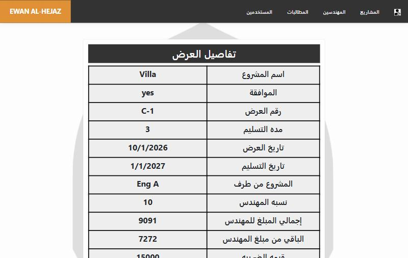
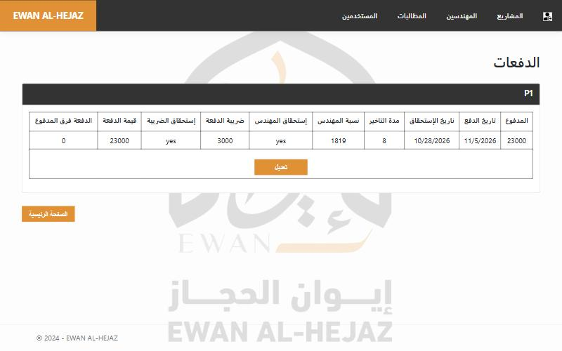

# Engineering Office Management System — Ewan Al-Hejaz

<div dir="rtl">

نظام ويب لإدارة مكتب هندسي: العملاء، عروض الأسعار والعقود، الدفعات، مستحقات المهندسين، الضريبة، والمطالبات المالية — في لوحة واحدة باللغة العربية.

</div>

A web system built for **Ewan Al-Hejaz**, an engineering office in Saudi Arabia, to track clients, contracts, payments, engineers' commissions, VAT and financial claims.


| Contract details | Payments |
|---|---|
|  |  |

## Features

- **Clients** — register clients, approve them, and see each client's total, paid and remaining balance.
- **Contracts / quotations** — one client can have many contracts; delivery date is derived from the start date and duration.
- **Automatic money rules** — every amount is VAT-inclusive (15%); the system splits it into net amount, VAT and the engineer's commission.
- **Payments** — record payments against a contract, track days late and over/under-payment, and mark when the engineer's share and the VAT have been settled. All balances are recalculated automatically.
- **Engineers** — per-engineer statement of contracts, commission earned, paid and outstanding.
- **Financial claims** — raise claims linked to a contract, listed per client or per contract.
- **Users & security** — cookie authentication, hashed passwords (ASP.NET Core Identity hasher), and an admin-only user management screen.

## Tech stack

ASP.NET Core 8 MVC · Entity Framework Core 8 (code-first migrations) · SQL Server · Razor views · Bootstrap 5 · jQuery validation

## Project structure

```
RenadWebApp/
├── Controllers/        Home (clients & contracts), Payment, Eng, Finaical, Login (auth & users)
├── Services/           ContractCalculator (VAT / commission / balances), UserService (hashing, admin seed)
├── Data/               ApplicationDbContext and relationships
├── Models/             Entities (DataModel) and view models
├── Migrations/         EF Core migrations
└── Views/              Arabic RTL Razor views
```

## Getting started

Requirements: [.NET 8 SDK](https://dotnet.microsoft.com/download) and SQL Server (LocalDB is enough).

```bash
git clone https://github.com/RENAD-MADI/engineering-office-management.git
cd engineering-office-management/RenadWebApp
dotnet run
```

The database is created automatically on first run. In development an admin account is seeded:

| Username | Password |
|---|---|
| `Admin` | `Admin@12345` |

For production, set your own values through environment variables instead of committing them:

```bash
ConnectionStrings__myCon="Server=...;Database=...;"
SeedAdmin__Password="a-strong-password"
```

## How the numbers are calculated

| Value | Formula |
|---|---|
| Net (before VAT) | `total × 100 / 115` |
| VAT | `total − net` |
| Engineer's share | `net − net × 100 / (100 + engineer %)` |
| Remaining on contract | `total − Σ payments` |
| Remaining for engineer / VAT | share − Σ settled payments |

## Author

**Renad Madi** — Full-stack developer · [GitHub](https://github.com/RENAD-MADI)
